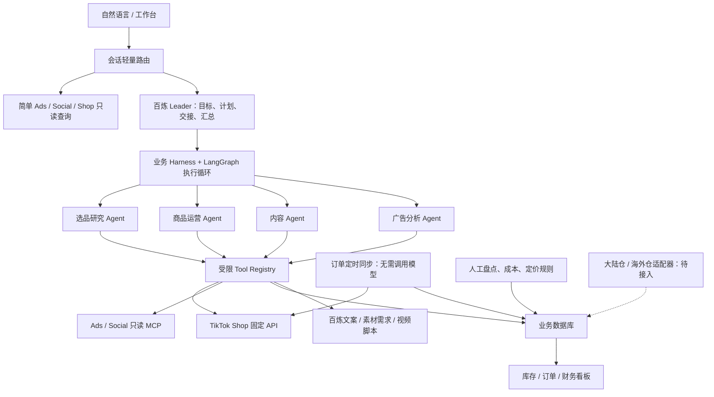

# v0.8 业务 Agent 与数据看板

这是已实现的第一批架构与业务基础：Leader 规划/汇总、四个受限业务角色、持久化后台执行、真实只读查询、内容与上架草案、多仓库存账和三类看板。**还没有实现真实素材生成、真实商品发布、广告修改或仓库 API。** 未连接的能力会停止任务，不模拟成功。

## 架构

Agent 是模型、角色目标、可用工具与有界执行逻辑的组合，四个角色共享执行实现，但有不同工具权限。仓库、订单、成本计算及看板是服务，不另设 Agent。无需 AgentTeams、CrewAI 或额外通用 Harness 框架。

- Leader：最多12个计划步骤，指定角色、工具、参数、依赖、完成标准；结构不合法时至多修正一次，校验通过才创建任务。规划阶段不会执行业务工具。
- research：市场 GMV 榜、联盟累计销量与内部经营快照。
- product：发现授权店铺、Shop 读取、内部商品/SKU、实物库存、上架草案。
- content：基于人工确认商品事实生成文案、图片需求和视频脚本；Social 只读分析。
- ads：真实广告账户匹配、广告分析；可接收其他步骤的业务上下文。仍然只读。
- Leader 在多步骤全部完成后汇总交付物。每个步骤单独限制预览长度，避免前一个大型结果挤掉后面的交付；完整数据始终在步骤记录。预算不足或汇总失败时保留各 Agent 原始交付，不伪造总报告。

当前按依赖顺序逐步执行，没有并行启动多个 Agent，也不支持运行中任意改变目标。复合任务可由会话创建；简单查询仍保留原直接路径。

## Harness 与循环

静态注册工具声明输入 Schema、角色权限、读/草稿/外部写副作用、版本、超时、是否已连接。模型不能动态注册工具、运行任意代码或授予自己权限。

流程：`自然语言 → 结构化计划 → 校验/必要时修正 → 开始 → 工具网关 → Agent 检查交付 → 下一步 → Leader 汇总`。

- 计划依赖必须指向前序步骤；`bindings` 只从已完成步骤的 `data` 读取真实值。绑定参数不得重复出现在 `arguments`。
- Shop ID 可先通过 `shop.discover` 获取，再绑定 `selected.id`；外部选品 ID 不能当作内部商品 ID。
- 普通专员在工具返回后进行至多两轮结构化检查。仅选品检索可调整一次关键词，其余市场、日期等已确认范围不变。草稿不自动重做。
- Ads/Social 复用现有至多6次只读工具循环，外层不重复增加检查循环。
- 缺资料为 `waiting_input`，能力未接入为 `blocked`，不会把空交付或草稿称为发布完成。
- 默认预算：模型20次、业务工具16次、受计数的外部业务请求60次、已报告 Token 50,000、活跃执行600秒。预算包括规划、检查和汇总；每次外发前检查。
- Token 额度是已报告用量的运行约束，输入 Token、请求失败或平台计费差异使它**不等于账单硬上限**。MCP 元数据/传输层请求未全部纳入业务请求计数。
- SQL 保存任务、步骤、版本、租约、交付和事件，LangGraph 驱动逐步执行。已落盘完成步骤重启后跳过；步骤内模型响应尚未落盘时可能重复调用并产生费用。
- 外部写操作审批绑定计划版本、计划哈希及实际解析后的参数。尝试后结果未知禁止盲目重试。当前真实发布工具禁用，审批通路由隔离测试工具验证。
- 工具调用记录参数、耗时、结果和证据；凭据字段/本机密钥脱敏。不记录或展示隐藏思维链。

采用受约束规划与工具观察循环即可支撑当前业务。暂不增加 ToT、多框架嵌套、任意代码沙箱、工具热插拔、自主灰度或自动回滚平台操作。

## 库存、订单、财务

### 库存

大陆仓与海外仓共用仓库表和内部 SKU。TikTok 库存永远是渠道展示数据，不会自动覆盖实物库存。

`可售 = 实物 − 仓库已占用 − 尚未反映在仓库的本地占用 − 安全库存`。

- 未盘点的 SKU/仓库组合为未知，不填0。记录超过24小时标记待复核，上架草案要求先复核。
- 手工库存调整含依据、版本与幂等操作号。订单行重复占用、重复出库和重复调拨收货不会重复扣加。
- 仓库接收占用后，本地占用退出，避免同一订单扣两次。只有确认实际出库才扣实物。
- 调拨出库扣源仓，运输中独立记录，目的仓确认实收后增加。未知目的仓库存需先盘点。
- 支持内部 SKU 与平台/仓库 SKU 映射；暂不自动根据平台订单扣仓库库存，避免未确认履约仓时误扣。
- 仓库 API 留空。页面提供建档、SKU、盘点和定价规则；占用、调拨、收货、映射操作先通过后端 API 提供，尚无完整页面表单或批量 CSV 导入。

### 订单与刷新

- 手工选择授权店铺和日期，将真实订单按工作区、店铺、订单去重保存。订单按创建时间查询，单次最多31天、5页，每次同步记录时间窗、完整性及平台 request_id。
- 可按店铺开启定时同步：最短60秒，默认300秒，回看1–31天。需要 worker 持续运行；长任务或接口限流可能推迟同步，不保证秒级实时。
- 定时同步只更新所选窗口，较早订单需要单独同步；看板展示数据库已保存快照，不冒充全店完整实时订单总数。未完成分页标记 partial，不补齐虚构数据。
- 看板每5秒刷新本地已保存数据。仓库目前人工维护，财务随订单与人工成本更新，不是每5秒向所有平台请求。
- 仅保存运营必要订单字段，过滤买家地址、电话、邮箱和留言。

### 财务与定价

- 按币种分别计算，区分所有状态订单金额、已支付且未取消订单金额。
- 成本未核对完整不计算利润。人工成本包括采购、物流、广告、平台费用、退款和其他成本；跨币种需先人工换算并注明依据。
- 完整成本订单的贡献估算 = 订单支付总额 − 各项成本；支付总额包含哪些项目以平台字段为准，并非广告 GMV。
- 若人工提供净结算额，已知结算利润 = 净结算额 − 采购 − 物流 − 广告 − 其他成本，不重复扣已包含的平台费/退款。
- 尚未接结算 API、广告成本自动分摊、汇率服务、税务或会计总账，不声称公司财务数据完整。
- 定价规则须人工保存到 SKU+市场，包含已换算到当地币种的成本、费率、目标利润率与渠道数量上限。商品 Agent 只读取，不能自行改成本。
- 上架草案冻结商品/库存/定价版本、建议价格和数量。还缺平台类目属性、实际图片、平台仓映射等资料。跨境仓履约规则未配置时会阻止将大陆仓库存当目标市场现货。

当前使用 qwen3.6 系列时，最终汇总显式设置 `enable_thinking=false`，减少简单归纳等待；其他模型维持原配置。参数依据：[百炼官方深度思考说明](https://www.alibabacloud.com/help/en/model-studio/deep-thinking)。这不涉及获取或保存模型隐藏思维链。

## 主要接口

接口需要 `X-Shop-ID` 工作区；配置了 APP_TOKEN 时携带工作台 Bearer 令牌。它是单一所有者工作台，工作区隔离不是多用户权限系统。详情见运行中的 `/docs`。

| 接口 | 用途 |
| --- | --- |
| `POST /api/operations/plan` | 百炼生成计划；暂不执行 |
| `POST /api/operations/{id}/start` | 指定 revision 开始/安全重试 |
| `PUT /api/operations/{id}/plan` | 修改非运行任务；产生新版本并清除审批 |
| `POST /api/operations/{id}/approval` | 对当前版本待审批操作作决定 |
| `GET /api/operations/{id}` | 状态、交付、Leader汇总、用量 |
| `GET /api/operations/{id}/traces` | 工具记录与证据 |
| `GET /api/operations/tools`、`/metrics` | 工具清单、基础运行统计 |
| `GET /api/business/dashboard` | 库存、订单和财务快照 |
| `POST /api/business/products`、`/skus`、`/warehouses` | 内部建档 |
| `POST /api/business/inventory/snapshot` | 确认盘点 |
| `POST /api/business/inventory/reservations` | 订单行占用 |
| `POST /api/business/inventory/reservations/{id}/action` | 仓库接收、实际出库、取消 |
| `POST /api/business/inventory/transfers`、`/{id}/receive` | 发出、收货 |
| `POST /api/business/sku-mappings` | 外部 SKU 映射 |
| `POST /api/business/orders/sync` | 按创建日期同步真实订单 |
| `GET/PUT /api/business/orders/sync-settings` | 查询/配置订单定时同步 |
| `PUT /api/business/orders/{shop_id}/{order_id}/finance` | 人工成本与净结算额 |
| `PUT /api/business/skus/{id}/pricing/{market}` | 人工定价规则 |
| `GET /api/business/drafts` | 持久化内容与上架草案 |

例：先 `POST /api/operations/plan`，内容为 `{"question":"查询MY店铺2026年11月18日订单，另查MY女士手表累计销量前3名，汇总结果。不修改平台数据。"}`；查看实际计划后，用返回 id 和 revision 调用 start。运行 `python -m app.worker`，通过任务详情轮询。普通会话明确要求执行查询时可直接排队，仍然不会自动批准外部写入。

## 选品口径

GMV 接口为官方脱敏区间榜，联盟接口的 `units_sold` 为累计销量。**两个接口的类目过滤都只支持一级类目**。细分类目需读类目树得到一级类目，再在返回样本内筛选；联盟累计销量查询按官方类目链筛选，最多扫描100个商品，返回覆盖说明。GMV 细分类目部分仅可按标题识别时单独标记候选，不当作完整细分类目榜。

仅当商品 ID 与 sale_region 一致才补充促销价和累计销量。TH 联盟请求实际曾返回 MY 商品，这些值不得拿来填 TH 商品。近7天销量仅能用同币种 GMV 区间÷当前SKU促销价区间做情景估算，不能当作历史实际销量。不足请求条数不凑数。

## 验收与边界

- 自动化检查覆盖任务版本、工具权限、输入校验、交接、预算、租约、外部操作未知结果、库存并发占用、防重复调拨、订单去重、多币种、缺成本、定时同步、模型计划修正及会话任务续查。
- 运行指标包括步骤/调用/已报告Token、耗时、完成/受阻/失败数量。completed表示计划步骤已交付，不代表建议有效、利润提高或任务范围一定拆分正确；业务质量仍需样例回放和人工验收。
- 本次真实查询只保存在本机数据库和仓库外验证文件，不提交GitHub。自动化模型/接口替身只能证明程序约束，不代替真实联调。
- 新表通过 create_all 初始化，正式部署还需版本化数据库迁移、备份和 PostgreSQL 专项验证。当前聚合读取本工作区快照，尚未实现大数据分页与增量聚合。
- 新页面已通过 TypeScript 与生产构建；本轮浏览器自动验收未完成，不能据此声称所有桌面/移动布局已视觉验收。
- 后续落地顺序：平台类目与媒体资料 → 百炼真实图片/视频任务适配器 → 版本化商品发布与平台状态核对 → 仓库 API/自动库存对账（待提供文档）→ 结算与广告成本归集。当前未接能力在注册表中禁用。
